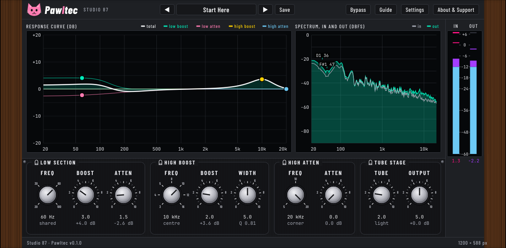

# Pawltec

A free, open source, cat-themed tube-style program equalizer (VST3) by Studio 87: a low boost and a low atten on one shared frequency, a high boost with adjustable width, a high atten, a tube stage and an Output level.

The real plugin window, rendered by the compiled editor (not the mockup).

## Status
Test build (pre-release). The plugin is built for Windows, macOS and Linux by CI, and the DSP core has automatic tests. Not yet checked: the installers on real machines, the plugin in real DAWs, and the sound by ear. The filter shapes are our own model, not measured from hardware. See [ROADMAP.md](ROADMAP.md).

## Download
Get the zip from the [Releases page](https://github.com/SpeakingColors/pawltec/releases): installers for Windows (.exe) and macOS (.pkg), a Linux Flatpak extension and a plain .vst3 tarball, the PDF manual, INSTALL.txt, LICENSE and SHA256SUMS. Everything works offline.

**Why Windows or macOS may warn you:** the installers are not signed with a paid publisher certificate (it costs money every year and this project is free), so Windows SmartScreen and macOS Gatekeeper warn about any unsigned installer. Windows: "More info", then "Run anyway". macOS: System Settings, Privacy and Security, "Open Anyway". Compare the files with SHA256SUMS; the source is here.

## Manual
[Pawltec manual (web page)](docs/index.html) and the PDF in each release, with an interface tour of the real window.

## Features
- 4 filter sections: low boost (up to +13.5 dB), low atten (up to -17.5 dB), high boost (up to +18 dB, narrow to wide), high atten (up to -16 dB)
- Tube stage at 4x oversampling with level match; exactly clean at 0
- Fixed 40 sample latency (reported to the host), smoothed knobs, bit exact bypass
- Live response curve with draggable handles, spectrum, in and out meters with dB scales
- 16 factory presets, your own presets (save, rename, delete, export, import)
- Resizable window, three colour looks, hover info bubbles (can be turned off)

## Build
CMake and a C++17 compiler: `cmake -S . -B build -DCMAKE_BUILD_TYPE=Release && cmake --build build`. JUCE 8.0.16 is fetched by CMake. Core tests without JUCE: `sh tests/run.sh`.

## Privacy
Collects nothing. No network access.

## Support

  

Free and open source, made by one person. If it helps your music, a coffee on [Ko-fi](https://ko-fi.com/studio87) keeps it coming.

## License
AGPL-3.0-or-later (built with JUCE under AGPLv3), see [LICENSE](LICENSE).
